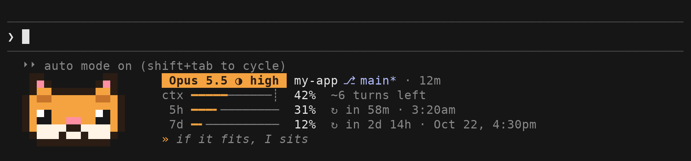
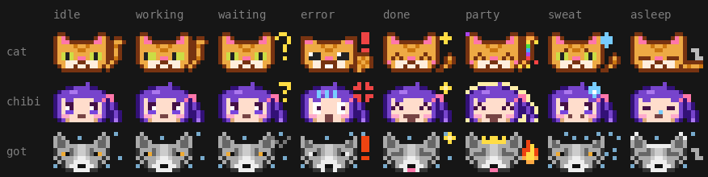

# awesome-hud

[](https://www.claudepluginhub.com/plugins/cosmos-127-awesome-hud?ref=badge)

An animated pixel mascot and status bar for Claude Code. The mascot reacts to Claude's activity; the bar shows your model, context, plan limits, and repository state. Optional theme sounds are off by default.



## Install

In a Claude Code terminal session:

```
/plugin install awesome-hud --marketplace cosmos-127/awesome-hud
```

Or install from a shell:

```sh
claude plugin install awesome-hud --marketplace cosmos-127/awesome-hud
```

Start a new session, or run `/reload-plugins` in an open one. The HUD appears below the prompt. It runs in terminal sessions, not in the Claude Code desktop app. The plugin uses Claude Code's early-access mods API, which may change.

## Update

Claude Code does not update third-party marketplaces on its own unless you turn on auto-update for this one in the Marketplaces tab of `/plugin`. To update by hand:

```sh
claude plugin marketplace update awesome-hud
claude plugin update awesome-hud@awesome-hud
```

Then restart Claude Code, or run `/reload-plugins` in an open session. You do not need to uninstall first.

## Usage

Nothing needs starting: once the plugin is loaded, the mascot and status bar sit under the prompt and follow the session.

- `/awesome-hud` lists the themes. `/awesome-hud bunny` switches to one and saves your choice.
- `/awesome-hud files` shows this session's edits, Git state, commits, and pull request.
- Type `pspsps` to summon the mascot; the text is still sent to Claude.
- `/config` changes the HUD's settings, listed below: where it sits, how much it shows, and whether it makes sound.
- To turn it off for a while, disable the plugin in `/plugin`.

## Themes

| Theme | Mascot | Sounds (optional) |
| --- | --- | --- |
| `cat` (default) | Opinionated orange tabby | Meows, hiss, 8-bit arpeggio |
| `chibi` | Teal-eyed character with a side ponytail | Sparkle, boing, fanfare |
| `creeper` | Green pixel face with square eyes and a blocky mouth | Hiss, pop, blips, chime |
| `hamster` | Wheel-running hamster with full cheeks | Squeaks, wheel, chirps |
| `duck` | Rubber duck in a rising bath | Squeaks, quacks, bubbles |
| `axolotl` | Smiling axolotl with frilled gills | Bubbles and blips |
| `bunny` | Pale pink bunny with expressive ears | Hops, thump, sniffs |

Themes provide their own mood animations and spinner text. Switching themes briefly shows a larger version of the mascot. The `creeper` theme is fan art of a character from a video game and is not affiliated with or endorsed by Mojang or Microsoft. Artwork is drawn pixel by pixel; sounds are generated by `scripts/sounds.py`.

## What the HUD shows

The HUD shows:

1. Model, effort, project folder (and worktree), session time, and cost.
2. Context usage and the auto-compact threshold (`┊`). From 70% full, it also names what takes the most of the context.
3. Five-hour and weekly plan usage, including reset time.
4. Git state, session edits, test results, and pull request status.
5. A status line with the current file or command (with how long it has run, past a minute). At rest it names what needs you: failing tests, a rebase or merge stopped halfway, a failed agent, or agents still at work. Otherwise it shows the mascot's quip.

At 85% context a toast suggests compacting.

```
⎇ main ↑2 ↓1       │ ● 3  ✚ 5  ? 1 new │ ≡ 1 stash
✎ 4 files +120 −34 │ ✓ 24 passed (3m ago) │ PR #42 ✓
```

Repository information uses two rows: Git state, then Claude's edits and test results.

| Part | Meaning |
| --- | --- |
| `⎇ main` | Current branch; shows rebase or merge progress when applicable. |
| `↑2 ↓1` | Commits ahead of and behind the upstream branch. |
| `● 3  ✚ 5  ? 1 new` | Staged, changed, and untracked files. A clean tree shows `✓ clean`; conflicts are highlighted. |
| `≡ 1 stash` | Number of Git stashes. |
| `✎ 4 files +120 −34` | Files Claude edited this session and lines added or removed. |
| `✓ 24 passed (3m ago)` | Latest test result and age; marked stale after a later edit. A repeat run that still fails says what it failed before: `✗ 2 failed (was 5, 3m ago)`. |
| `PR #42` | Pull request for this branch; checks and review appear with **PR status** enabled. |

When space is limited, less important details are hidden. Narrow or short terminals and **Layout** `compact` show two lines without the mascot. **Position** `above` moves the HUD above the prompt.

## Moods and sounds



| Mood | When |
| --- | --- |
| idle / asleep | Waiting for a prompt; sleeps after five quiet minutes |
| working | Claude is working |
| waiting | Claude needs permission or asks you a question |
| error | A tool or a test run fails, or the turn ends with an error |
| done | Claude finishes a turn |
| party | Tests pass, a commit or push completes, or you type `pspsps` |
| sweat | Context reaches 85% or a plan limit reaches 90%; shown in place of idle and done |

Enable **Sounds** in `/config` to hear theme sounds on errors (one per turn), permission requests and questions, parties, and completed turns lasting at least 30 seconds. An interrupted turn plays nothing. macOS and Windows use their built-in playback paths. Linux requires `pw-play`, `paplay`, or `aplay`.

## Terminals

The HUD adapts to terminal capabilities:

- **Color:** Mascot colors are chosen to remain distinct in 24-bit and 256-color terminals. Run `claude plugin test .` to check new themes.
- **Symbols:** **Symbols** can use Unicode marks, ASCII, or detect terminal support automatically.
- **Windows sounds:** Play through PowerShell. If playback fails, please report the terminal and Windows version.

If the mascot does not render well in your terminal, use **Layout** `compact` or report the terminal you're using.

## Settings

Configure the HUD in `/config`.

| Setting | Default | Description |
| --- | --- | --- |
| Theme | `cat` | `cat`, `chibi`, `creeper`, `hamster`, `duck`, `axolotl`, or `bunny`. |
| Position | `below` | Show the HUD below or above the prompt. |
| Layout | `full` | Show the mascot and stats, or use `compact` for stats only. |
| Symbols | `auto` | Detect Unicode support, or choose `unicode` or `ascii`. |
| Sounds | off | Play theme sounds for supported events. |
| Session cost | `auto` | Show cost when billed per token; hide it on Pro or Max plans. |
| Themed words | on | Use theme text in the spinner, turn summary, and event toasts. |
| PR status | off | Use `gh pr view` to show pull request checks and review. This is the only feature that uses the network. |

## Troubleshooting

- **No HUD.** Run `/plugin`: a dim line under the tabs counts the active mods (`1 mod active`). Mods need a terminal session and Claude Code 2.1.287 or later (awesome-hud is tested on 2.1.308), and are off under `--safe-mode`.
- **The mascot is missing and the HUD has two lines.** The terminal is narrower than 70 columns, or shorter than 25 rows with the HUD below the prompt, or has fewer than 7 rows free above the prompt with **Position** `above`, or **Layout** is `compact`.
- **The HUD disappears for a moment with Position `above`.** Claude Code is showing a survey there; the HUD comes back after it.
- **Boxes or blanks where the marks should be.** Set **Symbols** to `ascii`.
- **No Git row.** The folder is not a Git repository. Pull request checks need **PR status** on and `gh` signed in.
- **No sound.** **Sounds** is off by default. On Linux it needs `pw-play`, `paplay`, or `aplay`.

## Make a theme

A theme is a file in `hooks/themes/` and four WAV files in `sounds/<name>/`. See `hooks/theme.ts` for the theme fields.

1. Copy `hooks/themes/cat.ts` to `hooks/themes/<name>.ts` and rename the exported theme.
2. Draw an 18 × 10 sprite. Use columns 0–13 for the mascot and 14–17 for an idle detail or mood effects; at rest, something must stand in 14–17. Use `.` for transparent pixels and define each color in `palette`. Keep colors distinct in dark, light, and 256-color terminals; the theme's `accent` also colors the gauges, so it must show on a white terminal too.
3. Define all eight moods with the sprite helpers in `hooks/sprite.ts`, and a one-line text face for each, used when the band has no room for the sprite.
4. Add the theme's quips, tool verbs, spinner words, turn messages, party messages, and compact nudge, all in printable ASCII. The first quip of each mood is its headline: the website and the preview images show it.
5. Add `done.wav`, `error.wav`, `waiting.wav`, and `party.wav` under `sounds/<name>/`. Use `scripts/sounds.py` as a guide.
6. Register the theme in `hooks/themes/index.ts`, in `.claude-plugin/plugin.json` (the theme's `options` and `description`), and in this README's Themes and Settings tables.
7. Run `claude plugin test .`. It checks each frame's size and pixels, that every color is safe in 256-color terminals and stays apart from the colors it touches, the chip text's contrast, the ASCII text, and the sounds.
8. Run `python3 scripts/site.py` to add the theme to the website, and `python3 scripts/preview.py` to redraw the GIFs. CI fails a change to `hooks/` that leaves `index.html` out of date.

## Security and privacy

A mod runs inside Claude Code with your permissions and is not sandboxed. awesome-hud uses that access to watch the session, draw the HUD, and play optional sounds. It never rewrites a prompt, a tool call, or a permission decision, and it sends nothing anywhere unless **PR status** is on. `claude plugin validate .` prints every call the code makes; this is the same list in words.

| It | Details |
| --- | --- |
| Runs programs, never through a shell | `git rev-parse`, `git status`, and `git rev-list` in the session's repository, on a timer (paused after 30 minutes without a prompt or a tool call) and after edits, git commands, prompts, and turns. `tail -c` on a test run's saved output, when it is over 1 MiB. With **Sounds** on: Claude Code's own audio on macOS, `pw-play`, `paplay`, or `aplay` on Linux, and `powershell` on Windows (given the WAV file's path in an environment variable of its own), each playing a WAV file from this plugin; `uname -s` and a player's `--version` run once, to choose one. With **PR status** on, `gh pr view`. |
| Reads | The Git directory's `HEAD`, `config`, `FETCH_HEAD` (its time only), `commondir` in a linked worktree, and the files git keeps during a rebase, `git am`, merge, cherry-pick, revert, or bisect. Claude Code's saved output of a long test run. The variables `HOME`, `USERPROFILE`, `OS`, `TERM`, `TERM_PROGRAM`, `WT_SESSION`, `TERMINUS_SUBLIME`, `ConEmuTask`, and `TERMINAL_EMULATOR`. What Claude Code reports about the session: the model, usage, context, agents, every tool call and its result (to see edits, test runs, commits, and pull requests), and each prompt, only to spot `pspsps`. |
| Writes | One setting, `awesome-hud.theme`, when you run `/awesome-hud <theme>`. Nothing else is written, and no environment variable is set. |
| Uses the network | Only when **PR status** is on, and only through `gh`, with your own GitHub sign-in. The mod makes no request of its own. |
| Keeps | Nothing past the session except that one setting. There is no telemetry. |

What the HUD draws, such as the file or command Claude is working on, branch names, and commit hashes, stays on your screen. To report a vulnerability, see [SECURITY.md](SECURITY.md).

## Develop

```
git clone https://github.com/cosmos-127/awesome-hud
cd awesome-hud
claude --plugin-dir .              # reloads the mod each time you save
claude plugin test .               # the tests in hooks/awesome-hud.test.tsx
claude plugin validate --strict .  # what Claude Code will load, and anything it would refuse
python3 scripts/sounds.py          # rebuild sounds/ from the recipes in the script
python3 scripts/preview.py         # regenerate the preview GIFs and the website's link card (requires Bun and Pillow)
python3 scripts/site.py            # refresh the themes in index.html, the website (requires Bun)
```

The mod itself has no dependencies. The scripts need Python 3; `preview.py` also needs Bun, Pillow, and the DejaVu fonts. [CONTRIBUTING.md](CONTRIBUTING.md) maps the repository and says what CI checks.

## Changelog

Release notes are on the [Releases page](https://github.com/cosmos-127/awesome-hud/releases).

- **Unreleased:** On Apple Terminal, mascot pixels no longer bleed into the rows around them. The timer stops reading Git after 30 minutes without a prompt or a tool call. A session started again (after `/clear`) no longer runs a second set of timers. A tool cut short by an interrupt is no longer named in the status line. More invisible characters are stripped from names. Tested on Claude Code 2.1.308, with CI that runs the tests on that release and weekly on the newest.
- **0.4.2:** Reworked the `chibi`, `duck`, `axolotl`, and `bunny` themes, and rewrote theme messages across all seven.
- **0.4.1:** Fixed regular expressions that could stall the HUD on text a command or repository produces, and a crash on tools or files named like `constructor`. Added `SECURITY.md` and the community files. If you are on 0.4.0, update.
- **0.4.0:** Added the `creeper`, `hamster`, `duck`, `axolotl`, and `bunny` themes, and removed `got`.

## License

[MIT](LICENSE)
